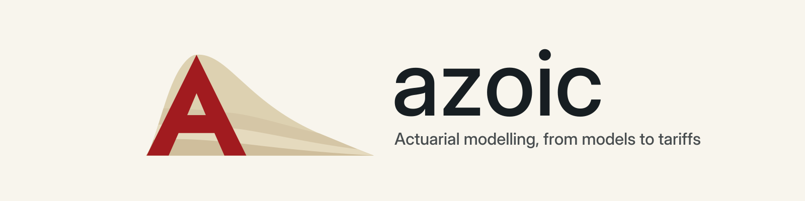

<p align="center">
  <a href="https://thomasbury.github.io/azoic/">
    <picture>
      <source media="(prefers-color-scheme: dark)" srcset="https://raw.githubusercontent.com/ThomasBury/azoic/1259918172c2787321d06a295337ef1e3a10a841/docs/images/azoic-brand-assets/azoic_brand/banner/azoic-readme-dark.png">
      
    </picture>
  </a>
</p>

<h1 align="center">Azoic</h1>

<p align="center"><strong>Non-life technical tariff and pure-premium modelling, inspectable by design.</strong></p>

<p align="center">
  <a href="https://pypi.org/project/azoic/"></a>
  <a href="https://thomasbury.github.io/azoic/"></a>
  <a href="https://github.com/ThomasBury/azoic/actions/workflows/ci.yml"></a>
  <a href="https://github.com/ThomasBury/azoic/blob/1259918172c2787321d06a295337ef1e3a10a841/LICENSE"></a>
</p>

<p align="center">
  <a href="https://thomasbury.github.io/azoic/"><strong>Website &amp; docs →</strong></a>
</p>

<p align="center">
  <a href="https://thomasbury.github.io/azoic/getting-started/first-model/">First model</a> ·
  <a href="https://thomasbury.github.io/azoic/tutorial/index.html">Tutorial</a> ·
  <a href="https://pypi.org/project/azoic/">PyPI</a> ·
  <a href="https://github.com/ThomasBury/azoic">GitHub</a>
</p>

Azoic is a scikit-learn-compatible Python toolkit for non-life technical tariff
and pure-premium modelling. It keeps actuarial preprocessing, GLM (glum) and
GBM (LightGBM) fitting, frequency–severity decomposition, ranking and
calibration diagnostics, reproducible experiment runs, and multiplicative
tariff export in one explicit workflow.

> **Azoic means "without life."** The name points to non-life insurance.

## Install

Azoic 0.6.1 requires Python 3.12 or newer and pandas 3.0 or newer.

With [uv](https://docs.astral.sh/uv/):

```bash
uv add azoic==0.6.1
uv run azoic --help
```

With pip:

```bash
python -m pip install azoic==0.6.1
azoic --help
```

Azoic is pre-1.0: minor releases can include documented compatibility changes.
Pin a version for production work and read the [changelog](https://github.com/ThomasBury/azoic/blob/main/CHANGELOG.md)
before upgrading. Earlier releases remain installable, but this
README and the documentation target 0.6.1.

## First model

> **New here?** The [first-model guide](https://thomasbury.github.io/azoic/getting-started/first-model/)
> generates a synthetic portfolio, compares a Tweedie GLM with a raw-feature
> GBM, and exports the fitted GLM to Excel. It needs no checkout, external data,
> or Quarto.

The guide builds `train` and `validation` frames. The core API shape is:

```python
from azoic.metrics import calibration_table, gini, op_ratio
from azoic.models import RiskGLM
from azoic.tariff import export_tariff

features = ["driver_age", "vehicle_age", "region"]
glm = RiskGLM(family="tweedie", link="log", exposure_col="exposure", tweedie_power=1.5)
glm.fit(train[features + ["exposure"]], train["claim_amount"] / train["exposure"])
rates = glm.predict(validation[features + ["exposure"]])

gini(validation["claim_amount"], rates, validation["exposure"])
op_ratio(validation["claim_amount"], rates, validation["exposure"])
calibration_table(validation["claim_amount"], rates, validation["exposure"])
export_tariff(glm, "tariff.xlsx", recalibrate=False)
```

## Why Azoic

- **Actuarial preprocessing.** `AutoBinner` and `AutoGrouper` learn inspectable
  strata and category groups with native LightGBM trees, missing routing,
  credibility floors, and fixed mappings that survive refits.
- **GLM, GBM, and frequency–severity in one vocabulary.** `RiskGLM` (glum),
  `RiskGBM` (LightGBM), and `FrequencySeverityModel` share scikit-learn
  `fit`/`predict` semantics and pure-premium rate targets.
- **Diagnostics that pair ranking with calibration.** Gini and Lorenz curves,
  lift, calibration tables, one-way and double-lift views, temporal stability,
  and observed/predicted ratios.
- **Reproducible runs.** `ExperimentConfig`, `run_experiment`, `save_run` and
  `load_run` keep data contracts, preprocessing, split membership, versions,
  and fitted candidates together.
- **Tariff operations, not only fitting.** GBM-to-GLM distillation, structural
  or recalibrated workbook export, controlled revisions, tariff review,
  final-test evaluation, and versioned production bundles.
- **Agent skills included.** The package ships modelling, diagnostics, and
  tariff skills for compatible agents; see the [agent skills guide](https://thomasbury.github.io/azoic/getting-started/agents/).

## Four correctness rules

1. **Exposure is a weight, not an offset.** Model pure-premium rates with
   `y = claim_amount / exposure` and `sample_weight = exposure`; the configured
   `exposure_col` does this inside `X`. Add `log(exposure)` as an offset only
   when the target is aggregate claim amount, never both.
2. **Frequency and severity stay separate.** Frequency models use
   `claim_count / exposure` with Poisson and exposure weights. Severity models
   fit only rows with `claim_count > 0`, using Gamma on positive average claim
   amounts; `FrequencySeverityModel` applies that filter internally.
3. **Ranking is not calibration.** Gini and Lorenz measure concentration, with
   tied scores aggregated before integration. They say nothing about rate
   level, so always pair them with a calibration table and the observed/predicted
   ratio.
4. **Evaluation boundaries are explicit.** Temporal splits keep equal
   timestamps together. Tune on an inner split of training data, reserve final
   test records before experimenting, and evaluate that final test once. Keep
   development validation, final evidence, and production refit distinct.

## Documentation

**Start**

- [Installation](https://thomasbury.github.io/azoic/getting-started/installation/)
- [First model](https://thomasbury.github.io/azoic/getting-started/first-model/)
- [Agent skills](https://thomasbury.github.io/azoic/getting-started/agents/)

**Guides**

- [Actuarial workflow](https://thomasbury.github.io/azoic/guide/actuarial-workflow/)
- [Data profiling and preprocessing](https://thomasbury.github.io/azoic/guide/data-preprocessing/)
- [Model choice and fitting](https://thomasbury.github.io/azoic/guide/model-choice/)
- [Experiments and CLI](https://thomasbury.github.io/azoic/guide/experiment-configuration/)
- [Diagnostics and visualization](https://thomasbury.github.io/azoic/guide/diagnostics-visualization/)
- [Reporting and operations](https://thomasbury.github.io/azoic/guide/operations/)

**Tutorial**

- [freMTPL2 tutorial series](https://thomasbury.github.io/azoic/tutorial/index.html)
- [Tutorial bridge](https://thomasbury.github.io/azoic/guide/fremtpl2/)

**Reference**

- [Configuration and CLI](https://thomasbury.github.io/azoic/reference/configuration-cli/)
- [Data and preparation](https://thomasbury.github.io/azoic/reference/data-preparation/)
- [Models and evaluation](https://thomasbury.github.io/azoic/reference/models-evaluation/)
- [Compatibility and composition](https://thomasbury.github.io/azoic/reference/compatibility/)
- [Workflow and operations](https://thomasbury.github.io/azoic/reference/workflow-operations/)
- [Glossary](https://thomasbury.github.io/azoic/reference/glossary/)

**Project**

- [Changelog](https://github.com/ThomasBury/azoic/blob/main/CHANGELOG.md)
- [Contributing](https://github.com/ThomasBury/azoic/blob/1259918172c2787321d06a295337ef1e3a10a841/CONTRIBUTING.md)

## Scope

Azoic models claim frequency, severity, and pure-premium technical tariffs. It is
not a reserving, fraud, policy-administration, or AutoML system.

## Development

See [Contributing](https://github.com/ThomasBury/azoic/blob/1259918172c2787321d06a295337ef1e3a10a841/CONTRIBUTING.md)
for checkout setup, checks and documentation commands.

## License

MIT. Copyright (c) 2026 Thomas Bury. See [LICENSE](https://github.com/ThomasBury/azoic/blob/1259918172c2787321d06a295337ef1e3a10a841/LICENSE).
